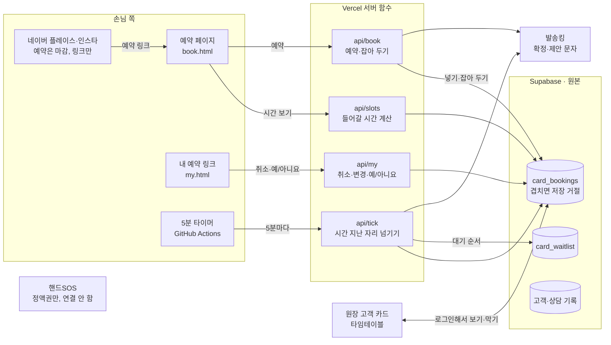

# 자체 예약 설계안

> 2026-10-29 젬마 코칭 1~3차 논의를 합친 것. 그림이 있는 페이지는 [참고/자체예약_설계.html](참고/자체예약_설계.html).

## 1. 문제를 다시 보기

오버부킹은 **지킬 조건**이고, 실제로 손해가 나는 곳은 두 군데입니다.

| | 무엇 | 왜 생기나 |
|---|---|---|
| 손님 · 찾기 | 빈 시간을 못 찾고 포기 | 네이버는 날짜·시간을 먼저 고르고 시술을 나중에 고름. 안 맞으면 처음 화면으로. 예약이 일주일 넘게 밀리면 날짜마다 눌러 보다 포기 |
| 원장 · 채우기 | 대기 수요가 있어도 빈자리 | 취소·변경으로 생긴 자리를 알리는 길이 없음 |
| 가게 · 지킬 것 | 동시 예약 0 | 손님 상태를 먼저 읽고 제안하는 상담 방식이라 시선이 나뉘면 품질이 떨어짐 |

시술 길이 때문에 생기는 오버부킹은 지금 핸드SOS가 막고 있습니다(공식 페이지로 확인). 그래서 자체 예약을 만드는 이유는 오버부킹이 아니라 **찾기와 채우기**입니다.

## 2. 설계 원칙 세 가지

1. **시술 먼저, 그다음 들어갈 수 있는 시간만.** 안 되는 시간은 아예 안 보이니 "예약 불가" 화면이 생길 일이 없습니다. 첫 화면에는 가까운 빈자리를 늘 띄웁니다.
2. **겹침은 데이터베이스가 막는다.** 화면 코드가 아니라 저장소 규칙이 겹치는 예약을 거절합니다. 두 사람이 동시에 눌러도 한 명만 들어갑니다.
3. **취소가 시스템 안에서 일어나게.** 손님이 받은 링크로 직접 취소하면 그 순간 시스템이 압니다. 원장님이 옮겨 적을 필요가 없고, 대기 자동 제안이 여기서 시작됩니다.

## 3. 전체 구조도



- **사라지는 것:** 원장님이 네이버·핸드SOS 예약을 카드 타임테이블에 손으로 옮겨 적는 일.
- **그대로 쓰는 것:** 시술 시간표, 타임테이블, wait.html의 확인번호·하루 5번 제한·봇 거르기, 발송킹, 상담 기록.

## 4. 추천 스펙과 이유

### 기술 묶음 — 지금 그대로
정적 HTML + Vercel 서버 함수 + Supabase + 발송킹. 새 패키지 없음.
**왜:** 한 달 동안 82건을 이 묶음으로 만들었고 시험 281개가 돕니다. 새 틀(Next.js 등)로 옮기면 예약보다 틀을 배우는 데 시간이 더 듭니다.

### 원본 표 하나 — `card_bookings`
손님 예약, 대기 손님에게 잡아 둔 자리, 원장님이 막은 시간(휴무·개인 일정)을 전부 한 표에.

```sql
create extension if not exists btree_gist;

create table card_bookings (
  id          bigint primary key,                -- 카드의 다른 표처럼 번호를 정할지는 V0에서 정함
  kind        text not null default 'booking',   -- booking 손님 예약 / block 원장이 막은 시간
  status      text not null default 'confirmed', -- held 잡아 둠 / confirmed 확정 / canceled 취소
  slot        tstzrange not null,                -- 시작~끝 (시술 분 + 정리 시간)
  service     text, minutes integer,
  name        text, phone text, customer_id bigint,
  token       text unique,                       -- 손님 개인 링크 열쇠, 무작위 32자
  hold_until  timestamptz, wait_id bigint,
  source      text not null default 'web',       -- web 손님 / card 원장 / naver 옮겨 적음
  created_at  timestamptz not null default now(),
  exclude using gist (slot with &&) where (status in ('held', 'confirmed'))
);
alter table card_bookings enable row level security;
```

**왜:** 막아 둔 시간까지 같은 표에 넣어야 규칙 한 줄이 모든 겹침을 막습니다. `source = naver`는 전환 기간에 네이버 예약도 이 표에 옮겨 적어 같은 규칙으로 검사받게 하려는 것입니다.

### 들어갈 시간 계산 — `store.js`의 순수 함수
```js
availableSlots({ bookings, hours, minutes: 120, buffer: 10, from: '2026-12-01', days: 14 })
// → [{ date: '2026-12-01', times: ['10:00', '14:30'] }, ...]
```
시각 t가 되려면 t부터 t + 시술 분 + 정리 시간까지가 영업시간 안이고, 잡아 둠·확정·막아 둠 어느 것과도 안 겹쳐야 합니다.
**왜:** "4시간 매직세팅 뒤에 커트가 들어가나" 같은 경우를 `node --test`로 박아 둘 수 있습니다.

### 손님 예약 화면
첫 화면 가까운 빈자리 → 시술 고르기 → 조건 거르기(희망 달·평일/주말·시간대) + 되는 시간 → 이름·번호·동의 → 완료 + 확정 문자.
- 거른 결과가 비면 "이 조건으로 대기 걸기" 단추 하나. 조건이 대기 줄에 그대로 들어감.
- 완료 화면에 "캘린더에 넣기"(.ics).
- 결제는 받지 않음. 지금처럼 매장에서, 정액권은 핸드SOS.

**왜:** 손님 불편(날짜 먼저, 안 맞으면 처음으로, 날짜마다 조회)을 순서 하나로 뒤집습니다. 예약과 대기를 같은 조건으로 묶는 이유는 "찾다가 없으면 기다린다"가 손님에게는 한 흐름이기 때문입니다. 결제는 결제 회사 계약·환불·정산이 따라와 1인 개발 범위를 넘습니다.

### 손님 확인 — 처음엔 로그인 없음
확정 문자에 손님마다 다른 링크(`my.html?t=무작위 32자`). 그 링크로 보기·취소·변경. 문자 인증번호 로그인은 V5.
**왜:** 전화번호 뒷자리 4자리는 1만 가지라 몇 번 시도하면 남의 예약이 열립니다. 뒷자리만으로 로그인하게 하지 않습니다. 상담 기록처럼 민감한 것을 보여 줄 때는 문자 인증번호(6자리, 5분 유효, 시도 제한)가 꼭 필요하니 그 기능이 생기는 V5까지 미룹니다.

### 대기 자동 제안
취소 → 빈 시간 계산(앞뒤 빈칸까지) → 다음 대기 손님에게 잡아 둠(held) + 문자 예/아니요 → 예: 확정 / 아니요·시간 지남: 다음 손님 / 남은 대기 없음: 자리 엶.

| 취소된 자리까지 남은 시간 | 한 손님에게 잡아 두는 시간 |
|---|---|
| 3일 넘게 | 2시간 |
| 1~3일 | 1시간 |
| 24시간 안 | 20분 |
| 3시간 안 | 제안 안 함, 바로 엶 |

밤 10시~아침 9시에는 제안 문자를 보내지 않고 잡아 둔 시간도 멈춥니다. 표의 값은 처음 값이고 취소 기록을 보고 고칩니다.
**왜:** 잡아 둔 동안 표에 held 줄이 있어서 그 시간이 예약 페이지에 안 보입니다. 대기 손님이 "예"를 누르는 사이 다른 손님이 가져갈 수 없습니다. 다음 손님으로 넘기는 일은 누가 깨워 줘야 하는데 Vercel 무료 요금제의 크론은 하루 한 번뿐이라, GitHub Actions 예약 실행(무료, 5분 간격, 몇 분 늦을 수 있음)으로 `api/tick`을 부릅니다.

### 개인정보
- 받는 것은 이름·번호·시술뿐, 동의 체크 필수, 개인정보처리방침 한 장.
- 손님 페이지는 다른 손님의 이름·시간을 돌려주지 않음. 빈 시간만.
- V5의 "내 시술 기록"에 원장님 진단 메모를 그대로 보이지 않음. 보여 줄 칸을 따로 정함.

## 5. 네이버를 남기는 방식 (3차 논의)

전제: 네이버는 예약·페이를 쓰는 업체를 먼저 보여 준다(공식 자료로는 확인 못 함). 그래서 예약을 그냥 끄면 노출을 잃을 수 있습니다.

| 방식 | 노출 | 겹침 위험 | 정책 위험 | 원장님 일 |
|---|---|---|---|---|
| A 네이버 예약 끄기 | 줄 수 있음 | 없음 | 없음 | 없음 |
| **B 켜 두고 마감 + 안내·링크 (추천)** | 예약 상품은 남음. 영향은 V2에서 잼 | 없음 | 낮음. 외부 링크 사례가 제재 없이 돎 | 처음 한 번 마감 설정·안내 글 |
| C 빈 칸을 가짜 예약으로 채우기 | 오를 수 있음 | 없음 | 높음. 허위 예약으로 볼 수 있고, 제재 시 평점 5점 플레이스까지 잃음 | 매번 채우고 지우기, 숫자 오염 |
| D 신규 첫 방문만 네이버에 열기 | 유지 | 있음. 옮겨 적기 필요 | 없음 | 옮겨 적기 계속 |

B를 추천하고, V2에서 노출이 눈에 띄게 줄면 D로 갑니다. 안내 글에는 연락처가 아니라 예약 페이지 링크를 겁니다(연락처를 걸면 원장님이 다시 중간에 낌).

안내·소식 글 초안:
> 헤어원네스트는 시술마다 걸리는 시간이 달라서, 시술을 먼저 고르면 들어갈 수 있는 시간만 보여 드리는 예약 페이지로 예약을 받고 있어요. 아래 링크에서 원하시는 시술을 고르시면 가장 가까운 빈자리가 바로 보여요. 원하는 시간이 없으면 대기를 걸어 두세요. 자리가 나면 문자로 먼저 알려 드려요.

## 6. 버전을 이렇게 끊은 이유

- 버전이 끝나면 원장님이 직접 써서 확인할 수 있어야 한다.
- 손님이 보는 순간은 기초가 검증된 뒤여야 한다.
- 잘못되면 그 버전 전으로 되돌릴 수 있어야 한다.

V0을 원장님만 쓰게 한 이유는 표와 겹침 규칙이 나중에 고치기 가장 어려운 뼈대라서입니다. 대기(V3)를 실전(V2) 뒤에 둔 이유는 대기 자동 제안이 "손님이 링크로 취소한다"는 신호 위에서만 돌기 때문입니다. 전체 마감(V4)을 맨 뒤에 둔 이유는 노출처럼 되돌려도 바로 회복되지 않는 것이 걸려 있어서입니다.

## 7. 확인 안 된 것

- 네이버가 예약·페이 쓰는 업체를 먼저 보여 주는지, 마감 상태 예약 상품이 노출에 주는 영향 → V2에서 숫자로
- 허위 예약에 대한 네이버 정책 원문
- 잡아 두는 시간·버전별 기간은 처음 값
